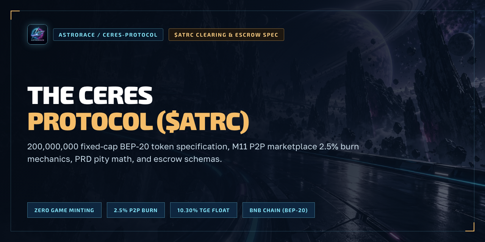
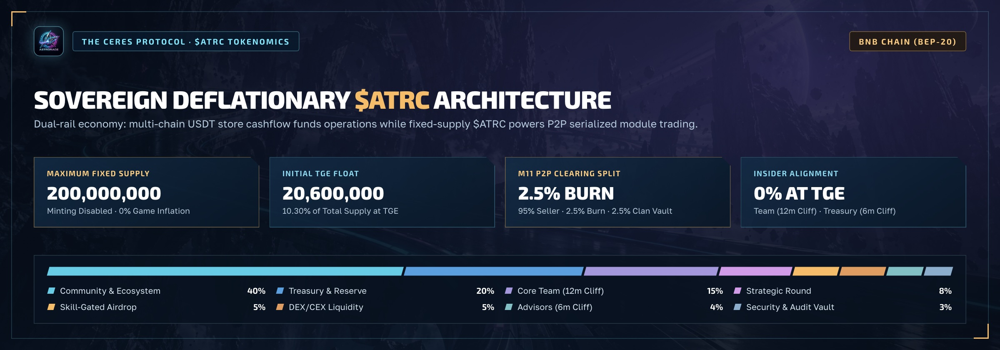

<p align="center">
  
</p>

# The Ceres Protocol (`$ATRC`) — Reference Economic & Clearing Specification

Reference TypeScript specification and verification suite for **ASTRORACE**'s fixed-supply token economy (`$ATRC`), `M11` peer-to-peer module marketplace clearing split, and Pseudo-Random Distribution (`PRD`) container pity guarantees.

- **Official Website:** [https://astrorace.app](https://astrorace.app)
- **Token Network:** `BNB Chain (BEP-20)` *(Exclusively on BNB Chain)*
- **Full Whitepaper & Docs:** [https://astrorace.gitbook.io/astrorace-docs/](https://astrorace.gitbook.io/astrorace-docs/) · [https://astrorace.app/docs/](https://astrorace.app/docs/)

---

## Key Invariants Verified in This Repository

1. **Hard Cap & Zero Gameplay Minting (`src/allocation.ts`):**
   - `ATRC_MAX_SUPPLY = 200,000,000` (`Minting Disabled` permanently; `0%` gameplay emission).
   - `ATRC_INITIAL_CIRCULATING_SUPPLY = 20,600,000` (`10.30%` at TGE).
   - `0%` TGE unlock for Core Team (`12-month` cliff + `36-month` linear) and Treasury (`6-month` cliff + `36-month` linear).
2. **Atomic `M11` P2P Marketplace Clearing (`src/clearing.ts`):**
   - **95.0%** (`9500 bps`) instant settlement to Seller.
   - **2.5%** (`250 bps`) permanently burned on every transaction.
   - **2.5%** (`250 bps`) routed to the Seasonal Syndicate Championship Vault.
   - Exponential anti-wash-trading capital decay: $C_N = C_0 \times 0.95^N$ (`> 51.2%` principal lost after 14 wash round-trips).
3. **Transparent `PRD` Container Pity (`src/pity.ts`):**
   - Base Legendary rate `2.5%`, linear Soft Pity escalation starting at container `41` (`+4.875%` per step), and deterministic `100%` Hard Pity guarantee at container `60`.

<p align="center">
  
</p>

## Running the Invariant Verification Suite

Requires Node.js `>= 22.6`:

```bash
npm test
```
